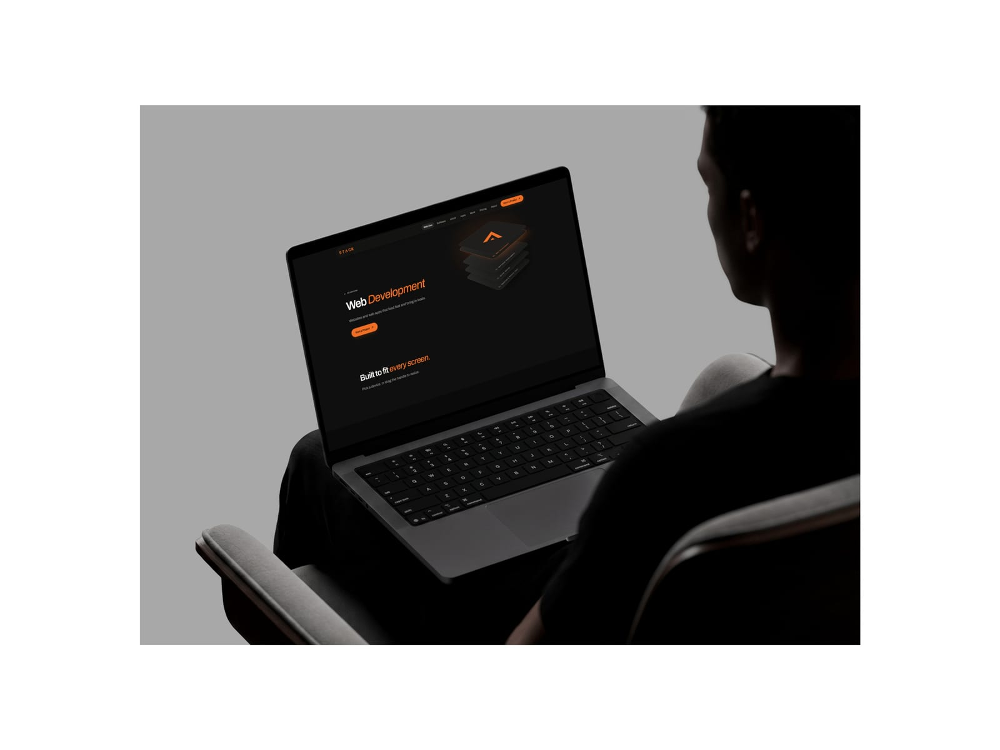
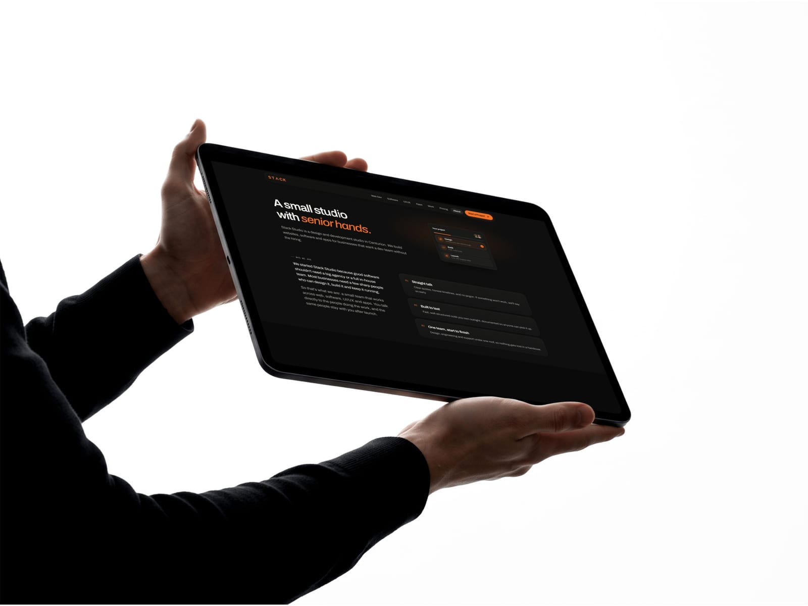
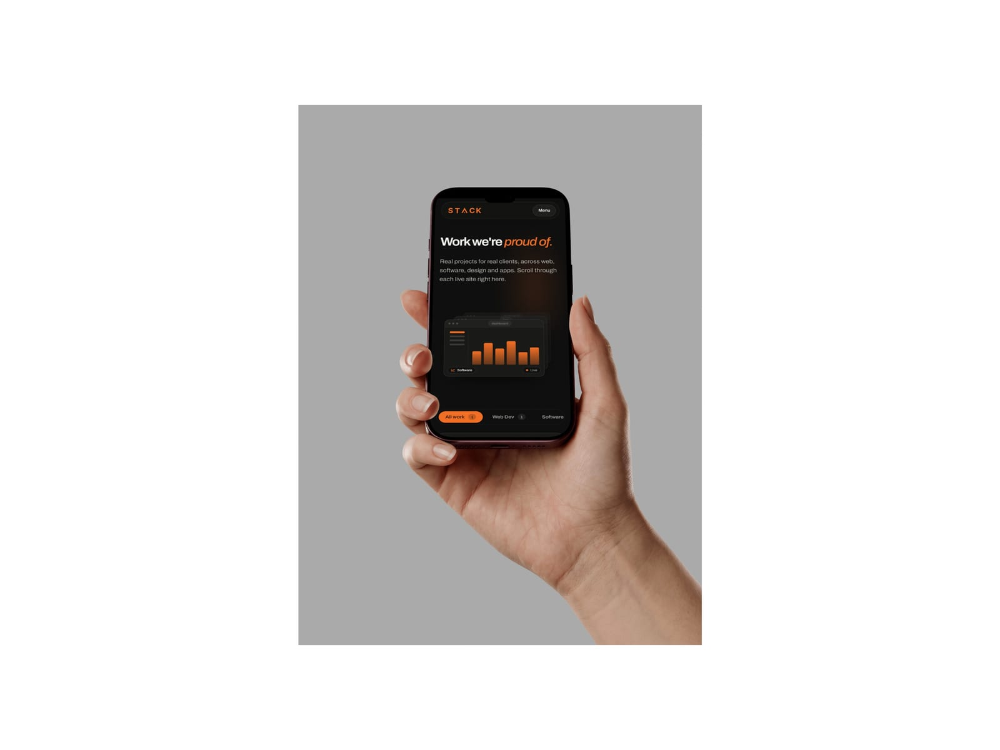
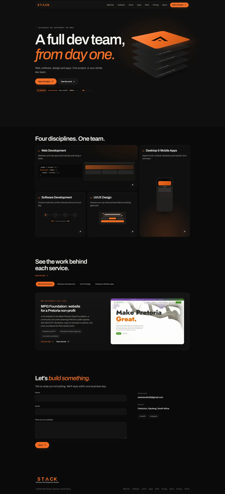
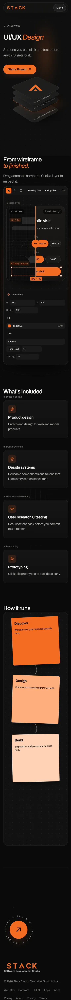
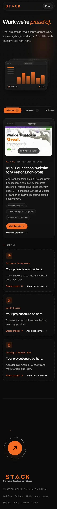

# Stack Studio

Marketing site for **Stack Studio**, a studio that does web, software, UI/UX design and mobile apps, either as one-off projects or as a standing dev team. Live at [stackstudio.co.za](https://stackstudio.co.za).

Built with **Next.js 16** (App Router), **React 19** and **TypeScript**, styled with plain CSS. There's no CSS framework and no CMS. All copy lives in one TypeScript file.

<p align="center">
  
</p>

<table>
  <tr>
    <td width="50%"></td>
    <td width="50%"></td>
  </tr>
</table>

## Showcase

### Video

<p align="center">
  <a href="docs/media/demo-video.mp4"></a><br>
  <sub>▶ <a href="docs/media/demo-video.mp4">Watch the demo video</a>: a desktop walkthrough of the site.</sub>
</p>

### Full-page screenshots

<details>
<summary><b>Home: desktop</b></summary>
<br>

</details>

<details>
<summary><b>UI/UX Design and Work: mobile</b></summary>
<br>
<table>
  <tr>
    <td width="50%" valign="top"></td>
    <td width="50%" valign="top"></td>
  </tr>
</table>
</details>

## Getting started

Requires **Node.js 20.9+**.

```bash
npm install
cp .env.example .env.local   # optional in dev, see Environment below
npm run dev                  # http://localhost:3000
```

| Script | What it does |
|---|---|
| `npm run dev` | Starts the dev server. It's also reachable from your phone on the same Wi-Fi (see [Testing on a phone](#testing-on-a-phone)). |
| `npm run build` | Production build. Every page prerenders statically. |
| `npm start` | Serves the production build. |
| `npm run typecheck` | `tsc --noEmit` |
| `npm run contact-photos` | Rebuilds the vCard contact photos from the team cutouts (see [Team & business cards](#team--business-cards)). |

> Stop `npm run dev` before you run `npm run build`. Both write to `.next/`, and running them together corrupts the dev server's cache.

## Pages

| Route | Source | Notes |
|---|---|---|
| `/` | `app/page.tsx` | Home |
| `/services/[slug]` | `app/services/[slug]/page.tsx` | Four service pages (`web-development`, `software-development`, `ui-ux-design`, `mobile-apps`), generated from `services` in `lib/content.ts`. Each one has its own interactive demo from `components/demos/`. |
| `/work` | `app/work/page.tsx` | Every case study, each with a scrolling full-page screenshot. |
| `/pricing` | `app/pricing/page.tsx` | Plan ladder, pricing planner and FAQ |
| `/about` | `app/about/page.tsx` | Company and team |
| `/contact` | `app/contact/page.tsx` | Contact form and details |
| `/card/[slug]` | `app/card/[slug]/page.tsx` | Standalone digital business card for each team member. It has no site nav or footer. |
| `/card/[slug]/contact.vcf` | `app/card/[slug]/contact.vcf/route.ts` | "Save contact" vCard download |
| `/api/contact` | `app/api/contact/route.ts` | Contact form endpoint |

## Project structure

```
app/           Routes, layout, and globals.css (design tokens on :root plus all component styles)
components/    UI: nav, footer, hero visuals, case studies, pricing, contact form, profile card, effects
  demos/       Interactive demos used on the service pages
lib/
  content.ts   ALL site copy: services, case studies, plans, FAQ, contact details, team, about
  site.ts      Live URL / current origin, card and vCard URL helpers
  contact.ts   Contact form validation (used on both client and server)
  vcard.ts     Builds vCards for team members
  specular-engine.ts, serviceSync.ts   Support code for visual effects and the hero ↔ services sync
public/
  brand/       Logo, mark, wordmark, pattern
  team/        Team cutouts (<slug>.webp) and generated contact photos (<slug>-contact.jpg)
  work/        Case-study screenshots
scripts/       contact-photos.mjs
docs/media/    README mockups, screenshots and demo videos (not used by the site)
```

## Editing content

You make almost every content change in **`lib/content.ts`**:

- **Services.** Edit names, ledes, "from" prices, what's included, and demo headings.
- **Case studies.** Add an entry to a service's `caseStudies` (newest first) and it appears on that service page and on `/work`. Screenshots go in `public/work/`. The `image` should be 16:10 (1600×1000). The optional `fullPage` screenshot should be 1000px wide, and you need to set its `height` because that value paces the scroll. A service with no case studies shows a "coming soon" panel.
- **Plans, FAQ, contact details and the about copy** each have their own export.

Styles live in `app/globals.css`. Change colours, type and spacing through the tokens on `:root`. The fonts (Archivo and Geist Mono) load in `app/layout.tsx` through `next/font`.

## Team & business cards

Each entry in `team` (in `lib/content.ts`) gets:

- a business card at `/card/<slug>`, which is what the team QR codes open
- a vCard download at `/card/<slug>/contact.vcf`

To add or update a team photo:

1. Put a transparent cutout at `public/team/<slug>.webp` and set `photo: "/team/<slug>.webp"`. If `photo` is `null`, the card shows initials instead.
2. Run `npm run contact-photos`. This composites the cutout over the brand backdrop and writes `public/team/<slug>-contact.jpg`, the photo that's embedded in the vCard. The script uses `sharp`, which gets installed along with Next.js.

## Environment

See `.env.example`. Put local values in `.env.local`. That file is gitignored.

| Variable | Purpose |
|---|---|
| `CONTACT_WEBHOOK_URL` | Where `/api/contact` POSTs each submission as JSON. Any webhook works: Zapier, Make, Zoho Flow, a Slack workflow, or your own endpoint. If it isn't set, dev accepts submissions and throws them away, and **production returns a 503** so leads are never silently lost. |
| `NEXT_PUBLIC_SITE_URL` | Optional. Overrides the public origin used for QR codes and metadata. The default is `https://stackstudio.co.za`. Set it to point cards at a staging site or a tunnel. |

The URL shown *to people* (for example the website on a saved contact) is always `liveUrl` in `lib/site.ts`, whatever this variable is set to.

## Testing on a phone

In dev, `next.config.ts` finds your machine's LAN IP, allows it as a dev origin, and points QR codes at `http://<lan-ip>:3000`. That means a phone on the same Wi-Fi can scan a team QR code and open the card on your dev server.

iOS only shares device-motion data with HTTPS pages. To test motion effects on an iPhone, run a tunnel:

```bash
npx cloudflared tunnel --url http://localhost:3000
```

`*.trycloudflare.com` is already allowed in `next.config.ts`.

## Deployment

The site is set up for **Netlify**. During a Netlify build, `next.config.ts` points QR codes and card links at the site being built: the primary URL for production, and the deploy URL for previews. On any other host, production falls back to `https://stackstudio.co.za` unless you set `NEXT_PUBLIC_SITE_URL`.

Remember to set `CONTACT_WEBHOOK_URL` in the host's environment, or the contact form will return errors.
